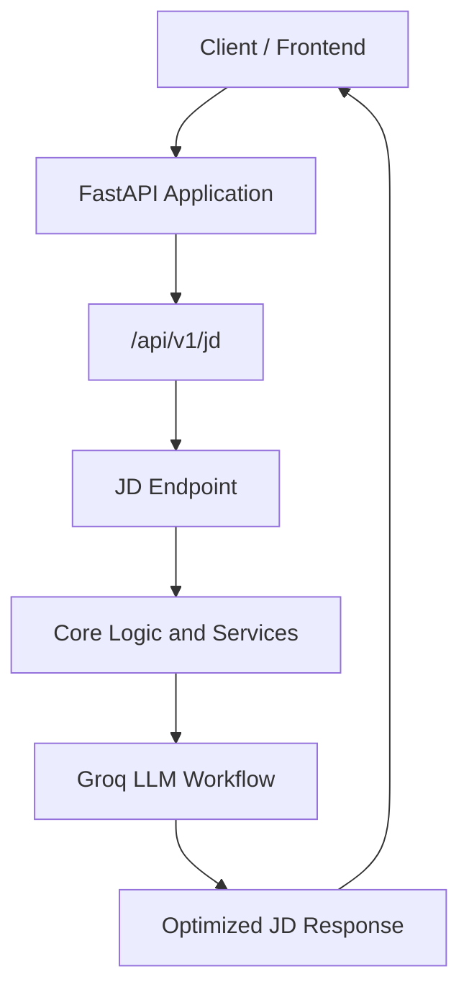

<div align="center">

# ✨ AI-Based Job Description Optimizer

### Turn job requirements into clearer, more effective job descriptions with AI.

A FastAPI-based application that connects a job-description API workflow with Groq-powered generative AI. Designed to make job-description optimization easier to access through a structured backend API.

<br/>


</div>

---

## 📌 Overview

Writing a strong job description takes more than listing responsibilities. A well-structured description should communicate the role, responsibilities, required skills, and expectations clearly to potential candidates.

**AI-Based Job Description Optimizer** is a Python application built around **FastAPI**, with a job-description API router and a Groq-powered workflow. Its goal is to provide an API foundation for AI-assisted job description improvement.

The repository includes backend-oriented modules for API endpoints, core logic, models, services, and public-facing assets.

> **Project note:** This README documents the architecture visible in the repository. Confirm the exact optimization features, request/response schema, and frontend launch procedure against the current implementation before publishing screenshots or example results.

## 🎯 Objectives

- Provide an API entry point for job-description optimization.
- Connect job-description endpoints to the application workflow.
- Use a Groq-backed language-model workflow for AI-assisted processing.
- Organize the code into API, core, model, and service modules.
- Establish a foundation for integrating an interactive frontend.

## ✨ Key Components

| Component | Purpose |
|---|---|
| ⚡ FastAPI application | Creates and configures the backend API. |
| 🧭 Job Description router | Exposes the JD-related API routes under `/api/v1/jd`. |
| 🤖 Groq integration | Provides the configured generative-AI connection referenced by the application. |
| 🧠 Core modules | Organize application logic. |
| 🧩 Models | Provide a place for application data structures and schemas. |
| 🛠️ Services | Separate supporting operations from API routing. |
| 🖥️ Public assets | Hold public-facing resources for the application. |

## 🏗️ Architecture



### Request flow

1. A client sends a request to the job-description API.
2. FastAPI routes the request to the JD endpoint.
3. The endpoint coordinates with the application's core logic and services.
4. The configured Groq workflow supports the AI-processing step.
5. The API returns a response to the client.

*The diagram is a high-level representation; exact internal calls depend on the current implementation.*

## 🧰 Technology Stack

- **Python** — backend application logic
- **FastAPI** — API framework
- **Groq** — language-model integration referenced by the application
- **Uvicorn** — ASGI server commonly used to run FastAPI applications

Confirm the exact installed package versions and any additional libraries in the project environment. A pinned dependency file is recommended for reproducible installation.

## 📂 Repository Structure

The repository currently exposes the following top-level components:

```text
AI-Based-Job-Description-Optimizer/
├── api/          # API routing and endpoint modules
├── core/         # Core application logic/configuration
├── models/       # Data models or schemas
├── public/       # Public-facing assets
├── services/     # Supporting service logic
├── src/          # Source modules
├── __init__.py
└── main.py       # FastAPI application entry point
```

The exact files within each folder may evolve. Keep this tree synchronized with the repository as modules are added or moved.

## ⚙️ Getting Started

### Prerequisites

- Python 3.10 or a compatible version supported by your environment
- Git
- A Groq API key if the active workflow calls Groq
- The project’s required Python packages

### 1. Clone the repository

```bash
git clone https://github.com/JyotiOjha/AI-Based-Job-Description-Optimizer.git
cd AI-Based-Job-Description-Optimizer
```

### 2. Create and activate a virtual environment

**Windows**
```bash
python -m venv .venv
.venv\Scripts\activate
```

**macOS / Linux**
```bash
python3 -m venv .venv
source .venv/bin/activate
```

### 3. Install dependencies

If the repository contains a dependency file, use it:

```bash
pip install -r requirements.txt
```

If no dependency file is present yet, install the core backend packages and add any additional packages required by the source code:

```bash
pip install fastapi uvicorn groq
```

For a shareable project, add a tested `requirements.txt` or `pyproject.toml` rather than relying on an ad hoc environment.

### 4. Configure environment variables

If the application reads a Groq API key from an environment variable, configure it in your local environment using the variable name expected by the code.

**Windows PowerShell**
```powershell
$env:GROQ_API_KEY="your_groq_api_key"
```

**macOS / Linux**
```bash
export GROQ_API_KEY="your_groq_api_key"
```

Check the implementation for the exact variable name before running. Never commit real API keys or secrets to GitHub.

### 5. Start the API

From the repository root, try:

```bash
uvicorn main:app --reload
```

The application entry point defines a FastAPI instance named `app`. If the project uses a package-qualified import path or a different working directory, adjust the command accordingly.

### 6. Open the API documentation

Once the server starts, visit:

- Swagger UI: `http://127.0.0.1:8000/docs`
- ReDoc: `http://127.0.0.1:8000/redoc`
- Root health/message endpoint: `http://127.0.0.1:8000/`

The root endpoint currently returns a simple running-status message. Use the Swagger UI to inspect the actual JD routes and their required request fields.

## 🔌 API Overview

The main application registers a job-description router with the prefix:

```text
/api/v1/jd
```

The precise HTTP methods, route suffixes, request body, and response format should be taken from the endpoint implementation. You can inspect them interactively in Swagger UI at `/docs` after starting the server.

### Suggested API documentation to add

For a developer-friendly API reference, document each endpoint with:

- HTTP method and path
- Purpose and expected use
- Required JSON fields and validation rules
- Example request and response
- Error responses and status codes

## 🧪 Testing Checklist

Before using the project in a demo or deployment, verify:

- [ ] The FastAPI application starts successfully.
- [ ] The root endpoint returns the expected response.
- [ ] The JD routes appear in `/docs`.
- [ ] Valid input is accepted and processed.
- [ ] Missing or malformed fields return useful validation errors.
- [ ] Groq configuration and API errors are handled gracefully.
- [ ] API keys are stored outside source control.
- [ ] CORS origins are restricted to trusted frontend domains before deployment.

## 🔐 Security & Responsible Use

- Keep API keys and other credentials in environment variables or a secrets manager.
- Do not commit `.env` files containing secrets.
- Configure CORS for the specific frontend origins you trust; permissive origins are suitable only for controlled development scenarios.
- Review generated job descriptions for accuracy, inclusivity, clarity, and compliance with applicable employment policies.
- Avoid including sensitive candidate information in prompts or logs.
- Treat AI output as a draft that should be reviewed by a recruiter or hiring manager.

## 🚀 Future Enhancements

- [ ] Add a clear web interface for entering and optimizing job descriptions.
- [ ] Provide before-and-after comparisons of the original and optimized descriptions.
- [ ] Add controls for tone, seniority, industry, and writing length.
- [ ] Highlight ambiguous wording, duplicated responsibilities, and missing role details.
- [ ] Add structured response schemas and endpoint examples.
- [ ] Add automated tests for API routes and service logic.
- [ ] Add dependency versioning and setup documentation.
- [ ] Add safe error handling, request logging, and rate-limit controls.
- [ ] Add deployment instructions and a demo screenshot.

## 🤝 Contributing

Suggestions and contributions are welcome.

1. Fork the repository.
2. Create a feature branch.
3. Make your changes and test them locally.
4. Open a pull request with a concise summary of the change.

## 👩‍💻 Author

**Jyoti Ojha**

[GitHub Profile](https://github.com/JyotiOjha) · [Project Repository](https://github.com/JyotiOjha/AI-Based-Job-Description-Optimizer)

---

<div align="center">

**Building clearer job descriptions with AI.** ✨

</div>
